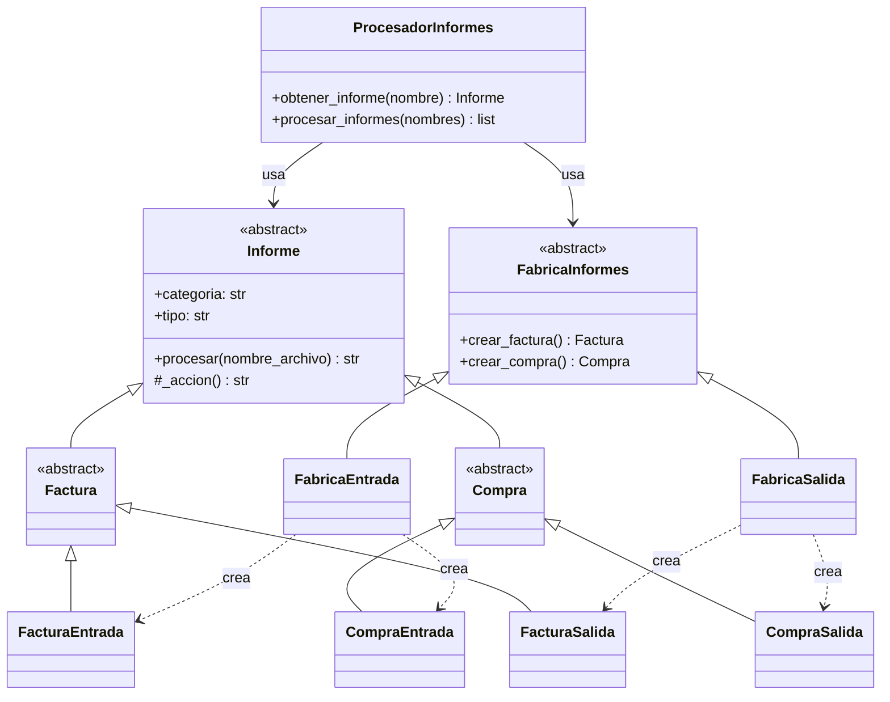
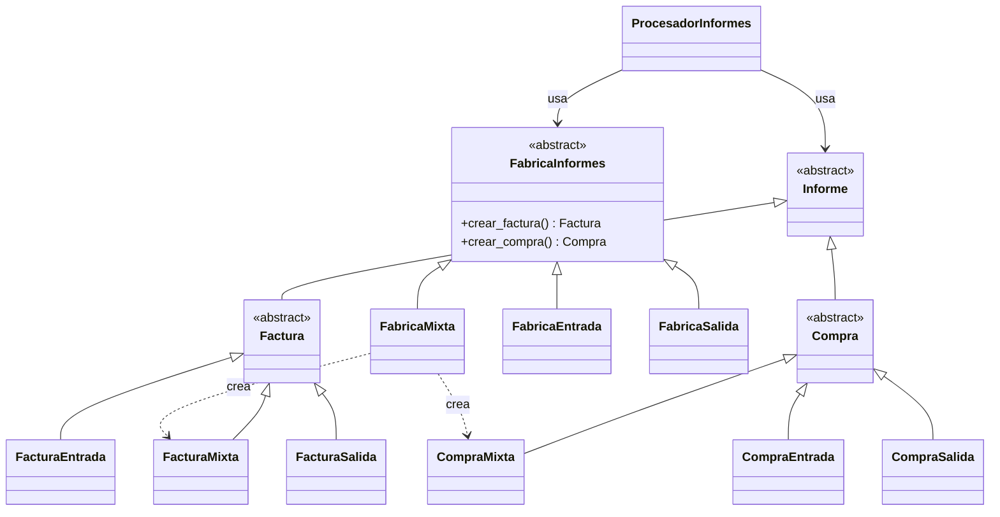
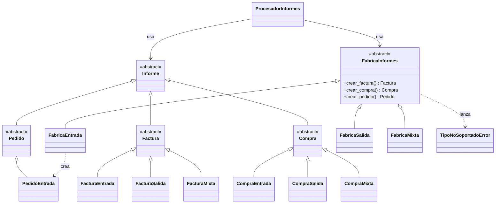

# Patrón Abstract Factory – Sistema para procesar informes

Actividad **Patrones de creación** – asignatura *Reutilización de Software* (UNIR).

> El enunciado plantea la implementación en Java; por indicación del profesor se implementa en **Python**.
> Las interfaces de Java se representan con clases abstractas (`abc.ABC` + `@abstractmethod`).
> Se utiliza **únicamente el patrón Abstract Factory**.

## Descripción del problema

Los informes llegan como una lista de nombres de archivo con el formato `CAT_TIPO_nombre.txt`:

| Código | Significado |
|--------|-------------|
| `ENT` / `SAL` / `MIX` | Categoría ENTRADA / SALIDA / MIXTA |
| `FAC` / `COM` / `PED` | Tipo FACTURA / COMPRA / PEDIDO |

Cada combinación categoría + tipo tiene su propia forma de ser procesada. El sistema simula el procesado mostrando por pantalla la categoría y el tipo de cada informe.

## Aplicación del patrón

| Rol del patrón | Clase |
|---|---|
| Fábrica abstracta | `FabricaInformes` |
| Fábricas concretas (una por **categoría** = familia) | `FabricaEntrada`, `FabricaSalida`, `FabricaMixta` |
| Productos abstractos (uno por **tipo**) | `Factura`, `Compra`, `Pedido` (todos heredan de `Informe`) |
| Productos concretos | `FacturaEntrada`, `CompraSalida`, `PedidoEntrada`, … |
| Cliente | `ProcesadorInformes` |

El cliente lee el código de categoría, obtiene la fábrica concreta correspondiente y le pide el producto según el tipo. Nunca instancia clases concretas, solo trabaja con `FabricaInformes` e `Informe`.

## Requisitos

- Python **3.9 o superior** (no requiere librerías externas).

Comprueba tu versión:

```bash
python --version
```

> En Linux/macOS puede ser necesario usar `python3` en lugar de `python`.

## Estructura del repositorio

```
.
├── ejercicio2_base/        # Ejercicio 2: categorías ENTRADA y SALIDA, tipos FACTURA y COMPRA
│   ├── productos.py        # Informe, productos abstractos y concretos
│   ├── fabricas.py         # Fábrica abstracta y fábricas concretas
│   ├── procesador.py       # Cliente: ProcesadorInformes
│   ├── main.py             # Programa principal
│   └── test_procesador.py  # Pruebas unitarias
├── ejercicio3a_mixta/      # Ejercicio 3a: + categoría MIXTA
├── ejercicio3b_pedido/     # Ejercicio 3b: + tipo PEDIDO en ENTRADA (versión final)
├── informes_ejemplo/       # Carpeta con archivos .txt de ejemplo
└── README.md
```

Cada carpeta es una versión completa y ejecutable, de modo que se puede comparar qué cambió en cada evolución.

## Cómo ejecutar

### 1. Clonar el repositorio

```bash
git clone https://github.com/mamejia7603-bot/patron-abstract-factory-informes.git
cd patron-abstract-factory-informes
```

### 2. Ejecutar cada versión con la lista de informes de prueba

```bash
python ejercicio2_base/main.py
python ejercicio3a_mixta/main.py
python ejercicio3b_pedido/main.py
```

### 3. Otras formas de ejecución

Procesar los informes de una carpeta:

```bash
python ejercicio3b_pedido/main.py --carpeta informes_ejemplo
```

Procesar nombres concretos pasados como argumentos:

```bash
python ejercicio3b_pedido/main.py ENT_PED_001.txt SAL_COM_002.txt
```

### 4. Ejecutar las pruebas unitarias

```bash
python -m unittest discover -s ejercicio2_base -v
python -m unittest discover -s ejercicio3a_mixta -v
python -m unittest discover -s ejercicio3b_pedido -v
```

### Salida esperada (versión final)

```
=== Ejercicio 3b: tipo PEDIDO en ENTRADA ===
Procesando informe de ENTRADA de tipo FACTURA [ENT_FAC_001.txt]
    -> Validando factura del proveedor y registrando cuenta por pagar
Procesando informe de ENTRADA de tipo COMPRA [ENT_COM_001.txt]
    -> Verificando recepción de mercancía y actualizando inventario
Procesando informe de ENTRADA de tipo PEDIDO [ENT_PED_001.txt]
    -> Registrando pedido recibido y reservando existencias
Procesando informe de SALIDA de tipo FACTURA [SAL_FAC_001.txt]
    -> Emitiendo factura al cliente y registrando cuenta por cobrar
Procesando informe de SALIDA de tipo COMPRA [SAL_COM_001.txt]
    -> Registrando orden de compra emitida y comprometiendo presupuesto
Procesando informe de MIXTA de tipo FACTURA [MIX_FAC_001.txt]
    -> Conciliando factura con movimientos de entrada y salida
Procesando informe de MIXTA de tipo COMPRA [MIX_COM_001.txt]
    -> Consolidando compra con movimientos de entrada y salida
[ERROR] La categoría SALIDA no tiene informes de tipo PEDIDO
[ERROR] Categoría desconocida 'XYZ' en 'XYZ_FAC_001.txt'
```

## Diagramas UML

### Ejercicio 2 – Sistema base



### Ejercicio 3a – Nueva categoría MIXTA



### Ejercicio 3b – Nuevo tipo PEDIDO en ENTRADA



> GitHub muestra estos diagramas automáticamente. Para exportarlos como imagen, pega el bloque en [mermaid.live](https://mermaid.live).

## Análisis de la evolución

**Nueva categoría MIXTA (3a).** Añadir una familia es el caso que mejor resuelve Abstract Factory: se crean `FacturaMixta`, `CompraMixta` y `FabricaMixta`, y en el cliente solo se registra `"MIX": FabricaMixta()`. No se modifica ninguna clase existente (principio abierto/cerrado).

**Nuevo tipo PEDIDO (3b).** Añadir un producto nuevo es el punto débil conocido del patrón: obliga a ampliar la interfaz `FabricaInformes` con `crear_pedido()`, lo que en principio afecta a todas las fábricas concretas. Para minimizar cambios, `crear_pedido()` tiene una implementación por defecto que lanza `TipoNoSoportadoError`, y solo `FabricaEntrada` la sobrescribe. Así `FabricaSalida` y `FabricaMixta` no se tocan.

## Autor

Michael Alexander Mejía Mejía – Universidad Internacional de La Rioja (UNIR)
